# Notch

**A free island for the top of your Windows screen, plus a dock-style taskbar, desktop widgets and a live wallpaper.**

Notch sits at the top of your screen as a small black pill. It shows what's playing, pops up when you change the volume or a notification arrives, and opens into a card with your music, files, clipboard, quick controls and widgets when you rest the pointer on it.

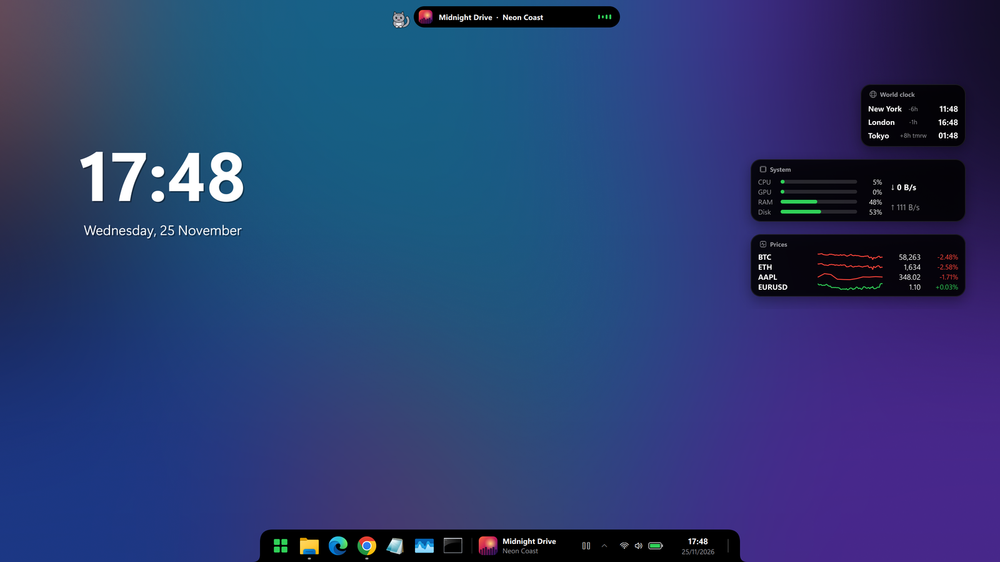

- **Free and open source.** No account, no ads, no telemetry.
- **Light.** About 20–35 MB of memory and well under 1 % CPU when idle. The [Performance](#performance) section has the numbers.
- **Event-driven.** It reacts to Windows instead of checking things over and over, so it stays asleep until something happens.

## Download

Get **`Notch-Setup.exe`** from the [latest release](../../releases/latest) and run it. No admin rights are needed: Notch installs for your user only.

- On the first run Windows may show **"Windows protected your PC"**, because the installer isn't code-signed. Click **More info → Run anyway**.
- Setup asks whether Notch should start with Windows, then starts it.
- To update, run a newer `Notch-Setup.exe`. It replaces the old version and keeps your settings.
- To remove it: **Settings → Apps → Installed apps → Notch → Uninstall**. Windows' own taskbar comes back exactly as it was.

Requires Windows 10 or 11 (64-bit). A few extras (Wi-Fi/Bluetooth toggles, some icons) work best on Windows 11.

---

## Features

### The island

The resting island shows the song that's playing, with its cover and a small visualizer. While a focus timer, a download or a screen recording is running, it shows that instead. Rest the pointer on it (or click it) and it opens.

**Popups** appear in the island and step aside on their own:

- volume, brightness, Caps Lock and Num Lock
- battery: charging, unplugged, low, full
- Windows notifications: click one to open its app
- reminders with Snooze and Done, and the end of a focus timer
- **microphone and camera in use**, plus an orange or green dot beside the island while they are
- headphones, speakers or Bluetooth audio connecting
- downloads from any browser: progress in the island, then **Open** and **Show** when the file is done

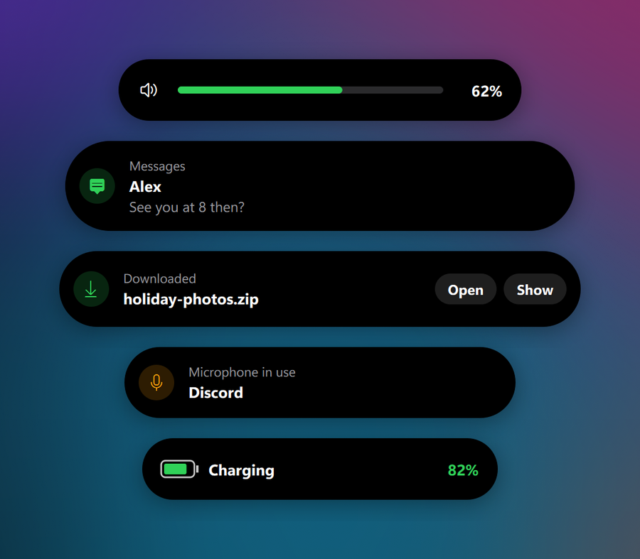

**Make it yours**

| Option | Choices |
|---|---|
| Shape | an island that floats, or a notch that hangs from the edge |
| Position | top centre, left or right |
| Screens | your main screen, every screen, or whichever screen you're working on |
| Surfaces | black, graphite, glass, white, midnight, ocean, forest, plum, sand, frost |
| Accents | 11 colours, or **Album cover**, which follows the colour of the song playing |
| Popup bar style | bar, thin, segments or dots |
| Pet | a small cat (four coats) that blinks, bobs its head to the music and naps when things are quiet |
| Privacy | hide the island and taskbar from screenshots, recordings and screen sharing |

### Music

Album art, seek bar, controls and volume. **Synced lyrics** scroll by in the card, with the line being sung highlighted; click a line to jump there. It works with any app that shows up in Windows' media controls: Spotify, browsers, Apple Music and most media players.

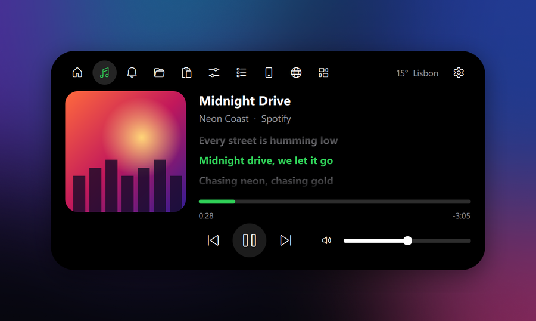

### Home

The time and date, the weather where you are, a focus timer (Pomodoro) and reminders. Type reminders the way you'd say them: `20m tea`, `19:30 call mum`, `tomorrow 9:00 dentist`.

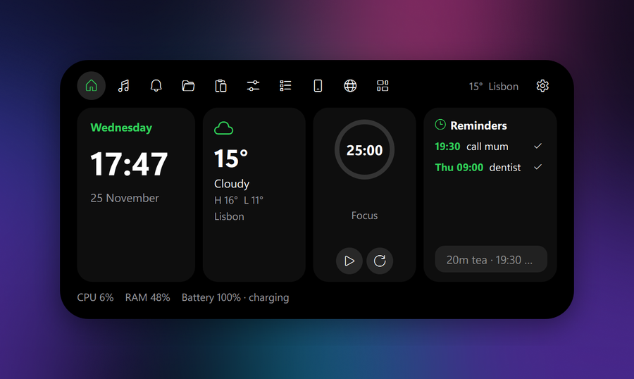

### Files, clipboard and snippets

- **Files shelf:** drag files onto the island to keep them there, then drag them out again, open them or show them in their folder. Screenshots and recordings land here too.
- **Clipboard history:** search, pin and reuse what you copied. It's stored encrypted for your Windows account, and copies from password managers are skipped.
- **Snippets:** texts you paste often. Star a clipboard entry or type a new one.

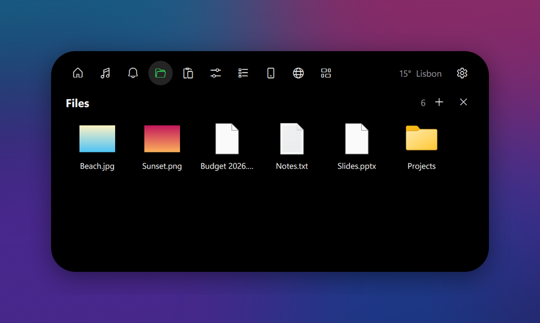
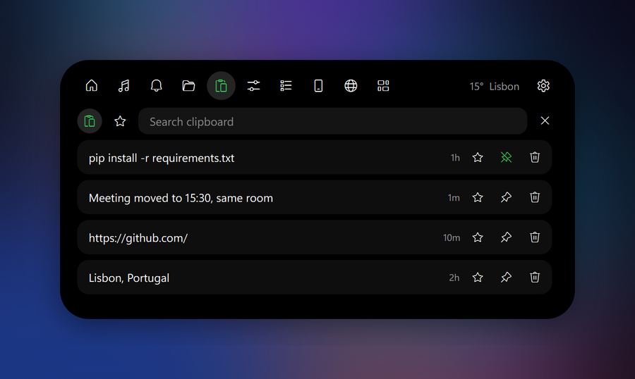

### Quick controls

Volume and brightness sliders, plus toggles for **Wi-Fi, Bluetooth, Night light, Mute, Mic off** and **Quiet** (no notification popups).

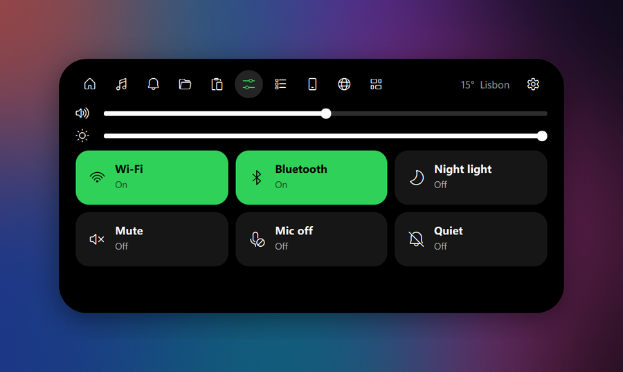

### Launcher, screenshots and screen recording

- **Screenshot** of this screen or of all screens: saved to *Pictures › Screenshots*, copied to the clipboard and added to the shelf.
- **Snip:** Windows' snipping tool.
- **Record** the screen to MP4, optionally with your microphone. The island shows a red REC pill; click it to stop.
- **Six slots** for apps, files or folders you open a lot. Drop something onto a slot, or click **+**.

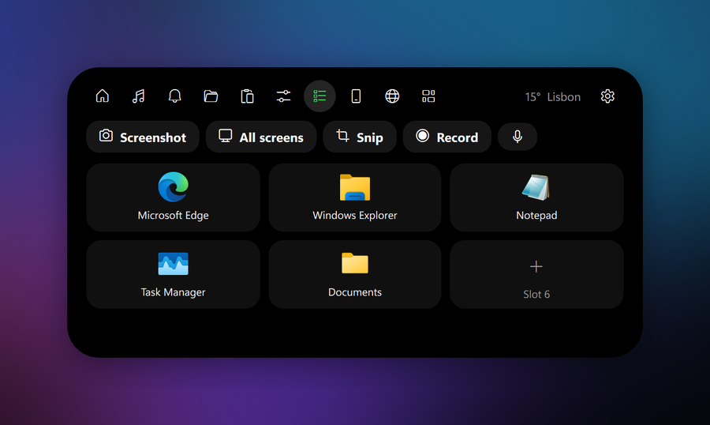

### Send to phone

Scan the QR code with your phone's camera to open a page served by your own PC, over your own Wi-Fi.

- **Phone → PC:** send photos and files of any size; send text, which lands on the PC's clipboard.
- **PC → phone:** download whatever is on the shelf.

No app or account is needed. The link carries a random code, and it stops working 10 minutes after the last use.

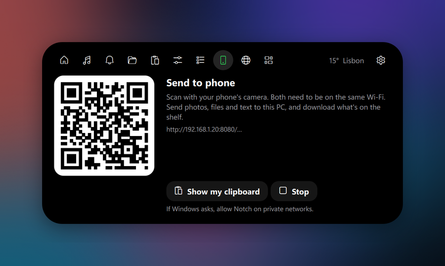

### Notifications

Your recent Windows notifications in one list; click one to open its app.

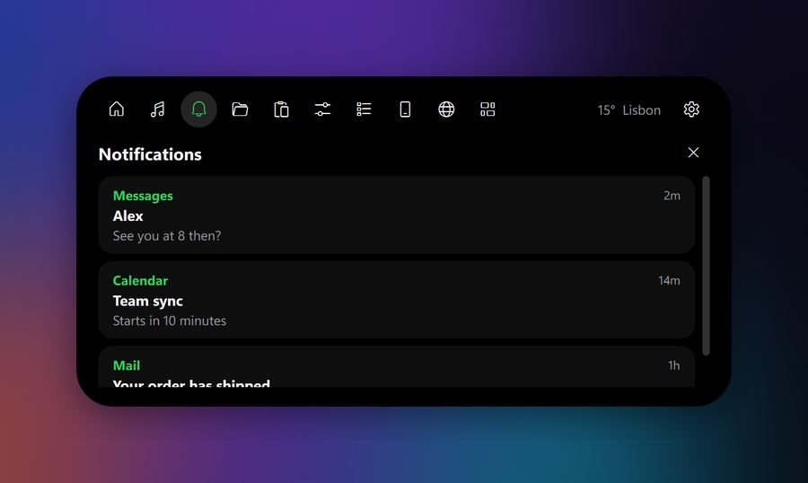

### Widgets

17 widgets for the island's Widgets tab. Right-click any widget to change it or to **put it on the desktop**.

| Widget | Shows |
|---|---|
| System | CPU, GPU, RAM, disk and network speed |
| World clock | up to three cities |
| Progress | how far through the day, week, month and year you are |
| Sun and moon | sunrise, sunset and the moon's phase |
| Air quality | European AQI, PM2.5, PM10 and UV |
| Prices | crypto, stocks and currencies with a day chart, plus alerts like `BTC-USD>70000` |
| Exchange rates | European Central Bank rates |
| Today | your calendar from its `.ics` link (Google, Outlook…) |
| To-do and Note | a task list and a scratch note |
| Countdown | days left until a date |
| Calculator | quick sums; Enter copies the result |
| Websites | whether your sites are up, with an alert when one goes down |
| Ping | latency, jitter and packet loss |
| Batteries | this PC and Bluetooth devices that report their battery |
| Screen time | time at the computer today, and time in fullscreen apps and games |
| Photos | a slideshow from a folder |

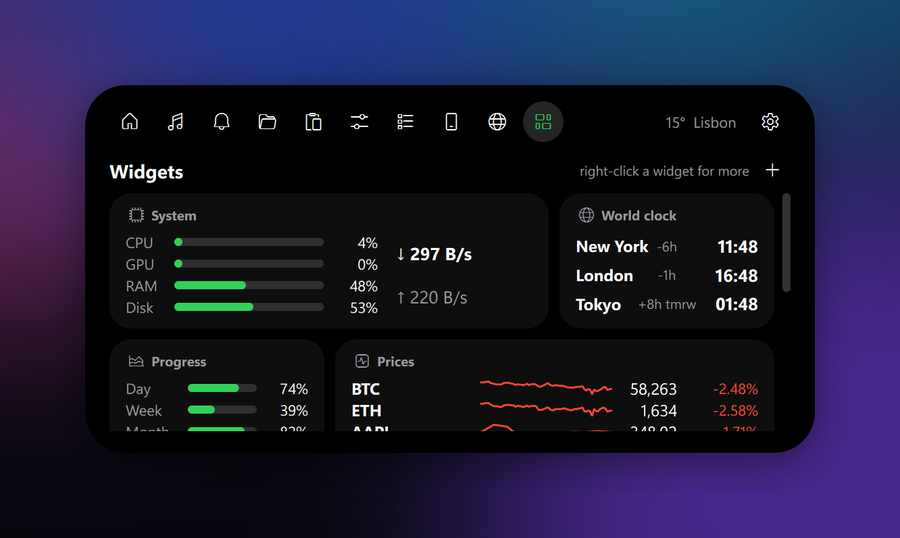

### Desktop

- **Desktop widgets** sit on your wallpaper above the icons. They stay put when you press Win+D, and you can drag them anywhere or lock them.
- **Day clock:** a big time and date on your desktop, in any size and colour.
- **Live wallpaper:** any video plays behind your desktop icons, muted and looping. It pauses while a window covers the screen or you're on battery, and unloads after two covered minutes to free memory.

### Taskbar (optional)

A dock-style taskbar that can replace Windows' own:

- Start, your pinned and open apps, the song playing, the timer, quick settings and the clock
- live window previews when you hover an app
- a dock effect that magnifies icons as the pointer passes
- **Win+1…9** for the apps on the bar, and your tray apps behind the `^` button
- a bar on every screen, each showing that screen's own apps

Windows' taskbar comes back exactly as it was when you turn this off or close Notch, even if Notch crashes.

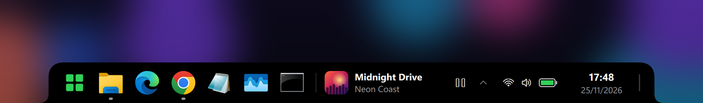

### Web (when running from source)

A small browser drops down under the island, for YouTube Music, YouTube and your pinned sites. Music keeps playing when you close it. It needs Qt WebEngine, which the installer leaves out to stay small, so it's available when you run Notch from source.

### Settings

Click the tray icon or the ⚙ in the island. Every change applies immediately.

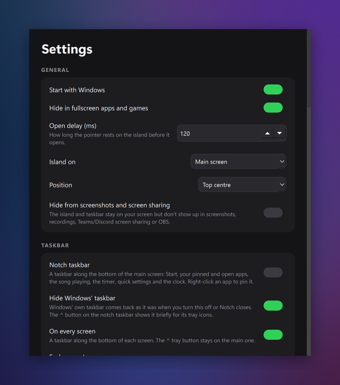

---

## Privacy

Nothing is collected or sent anywhere except what each feature needs, and only while you use it:

| Feature | What leaves your PC | Where to |
|---|---|---|
| Weather, sun and moon, air quality | the city you typed, and its coordinates | open-meteo.com |
| Synced lyrics (can be turned off) | the song's title, artist and length | lrclib.net |
| Prices and price alerts | the symbols you added | Yahoo Finance |
| Exchange rates | the currencies you picked | frankfurter.app (ECB data) |
| Today | a request to your calendar's own `.ics` link | your calendar provider |
| Websites and Ping | requests to the sites and host you added | those sites |

- **Clipboard history and snippets** are encrypted with your Windows account (DPAPI) and never leave the PC.
- **Send to phone** only works on your local network, behind a random code, and stops by itself.
- **Notifications** are read from Windows' own notification store, read-only.

## Performance

Measured over 45–60 seconds on a 16-core desktop with two screens and the taskbar on:

| Situation | CPU | Memory in use |
|---|---|---|
| Idle | under 1 ms/s (≈0.005 % of the PC) | 20–35 MB |
| Music playing (visualizer) | ~22 ms/s | 28–39 MB |
| Day clock + 3 desktop widgets | under 1 ms/s | ~33 MB |
| Live wallpaper playing (1440p video) | ~80 ms/s | ~140 MB |
| Live wallpaper covered | ~11 ms/s, then unloaded | ~29 MB |

How it stays this light:

- Notch waits for Windows to report changes instead of polling. That covers volume, media, battery, Caps Lock, notifications, downloads, mic/camera use and window changes.
- Timers only run while something on screen needs them.
- The heavy parts (the browser, the video player, the recorder) load only when you use them and are freed afterwards.

---

## Run from source

```powershell
git clone https://github.com/<you>/notch.git
cd notch
py -3.13 -m venv .venv
.venv\Scripts\python.exe -m pip install -r requirements.txt
.venv\Scripts\pythonw.exe run.py
```

`Start Notch.vbs` starts it without a console window. The Web tab uses Qt WebEngine, which `pip install PySide6` brings along.

Handy flags for development:

| Flag | Does |
|---|---|
| `--open home` | opens the card on a tab and keeps it open (`music`, `files`, `widgets`, …) |
| `--hud volume` | shows a sample popup (`battery`, `notification`, `reminder`, `mic`, `camera`, `device`, `download`) |
| `--settings` | opens the settings window |
| `--shot`, `--record 5` | takes a screenshot, or records 5 seconds |
| `--web URL` | opens the web panel |

Set `NOTCH_DATA` to a folder to run with separate settings. Normal data lives in `%APPDATA%\Notch`, and errors are logged to `notch.log` there.

### Build the installer

```powershell
.venv\Scripts\python.exe packaging\build.py
```

This writes `dist\Notch-Setup.exe`: a single-file installer with no admin rights needed. It installs to `%LOCALAPPDATA%\Programs\Notch`, adds Start-menu and Installed-apps entries, and uninstalls cleanly.

## Project layout

```
run.py                 entry point (also the installer's helper modes)
notch/
  app.py               wires everything together: popups, tray icon, settings
  island.py            the island window, animation, resting pill and popups
  card.py, panels.py   the open card and its tabs
  widgets.py           the 17 widgets
  desktop.py           desktop widgets, day clock, live wallpaper, background checks
  taskbar*.py, winbar.py, hotkeys.py, tray_apps.py   the taskbar
  media.py, system.py, notifications.py, clipboard.py, indicators.py, tools.py, phone.py, webpanel.py
  config.py, settings_ui.py, theme.py, pet.py
packaging/             installer build (PyInstaller)
```

## License

[MIT](LICENSE): free to use, change and share, including in your own projects.

Built with Python, [PySide6 (Qt)](https://doc.qt.io/qtforpython-6/), [PyWinRT](https://github.com/pywinrt/pywinrt), [pycaw](https://github.com/AndreMiras/pycaw), pywin32, psutil, segno and truststore.
